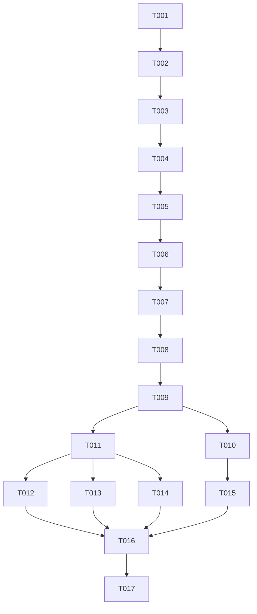

# Tasks: Chat API

**Input**: Design documents from `specs/002-chat-api/`

**Prerequisites**: `plan.md`, `spec.md`, `research.md`, `data-model.md`, `contracts/http-chat.md`, `quickstart.md`

**Tests**: Integration tests are required by FR-009. Write each story's deterministic tests first and confirm they fail before implementing that story.

**Organization**: Tasks are grouped by user story so each increment can be implemented and validated independently.

## Format: `[ID] [P?] [Story] Description`

- **[P]**: Task can run in parallel with another marked task because it changes a different file and has no unfinished dependency.
- **[Story]**: User story served by the task; setup and foundational tasks have no story label.
- Each task description names its exact implementation or validation path.

## Phase 1: Setup

**Purpose**: Establish the HTTP app and executable entry point using the existing dependencies.

- [x] T001 Create an injectable Express app factory in `src/http/server.ts` and a direct-execution bootstrap in `src/index.ts`; importing either module must not start a listener.

## Phase 2: Foundational

**Purpose**: Establish one shared strategy source before story-specific endpoint behavior.

- [x] T002 Create the base name-to-strategy registry for `react` and `plan-and-execute` in `src/agents/index.ts`.
- [x] T003 Refactor `src/arena.ts` to derive its current base and `reflect:<name>` entries from `src/agents/index.ts`, preserving its existing default strategy selection.

**Checkpoint**: The app can be configured with a strategy map, and the CLI and HTTP API can use the same base strategy definitions.

## Phase 3: User Story 1 - Submit a chat request (Priority: P1) - MVP

**Goal**: A caller receives a complete answer, trace, and metrics for a valid message, using `react` when no strategy is supplied.

**Independent Test**: Run the HTTP integration test with deterministic fake strategies and verify status `200`, the response shape, default strategy selection, and explicit supported strategy selection without external service calls.

### Tests for User Story 1

- [x] T004 [US1] Add failing `POST /chat` integration tests for omitted and explicit strategy selection, success status, and `answer`/`trace`/`metrics` in `src/http/server.test.ts` using deterministic fake strategies.

### Implementation for User Story 1

- [x] T005 [US1] Define Zod request and response schemas in `src/http/server.ts`; preserve the data-model constraints verbatim: `message` is "Trimmed and non-empty", `strategy` "Must resolve to a registered base strategy; omitted means `react`", and `reflect` "Omitted means `false`"; validate response `answer`, trace variants, non-negative integer `IICalls`, and finite non-negative `latencyMs`.
- [x] T006 [US1] Implement the successful `POST /chat` handler in `src/http/server.ts` to parse the request, select `react` by default or the named registry entry, invoke it, validate its result, and return status `200` with `answer`, `trace`, and `metrics`.

**Checkpoint**: The valid non-reflective chat flow is independently testable and returns the documented response shape.

## Phase 4: User Story 2 - Request reflective reasoning (Priority: P2)

**Goal**: A caller can request reflection for a supported base strategy without changing the response shape.

**Independent Test**: Run integration cases with `reflect` omitted and enabled, using a deterministic strategy and injected deterministic critic; verify reflection is applied only when requested and both cases return the common response shape.

### Tests for User Story 2

- [x] T007 [US2] Add failing integration tests for `reflect: false`, omitted `reflect`, and `reflect: true` in `src/http/server.test.ts`, injecting a fake critic so the test makes no external service calls.

### Implementation for User Story 2

- [x] T008 [US2] Apply `withReflection` to the selected base strategy only when `reflect` is true in `src/http/server.ts`, and expose injectable `ReflectionOptions` for deterministic tests while keeping the production critic default.

**Checkpoint**: Both reflective and non-reflective requests pass independently with the same response contract.

## Phase 5: User Story 3 - Receive actionable request errors (Priority: P2)

**Goal**: Invalid bodies, unsupported strategy names, and requests reaching the processing deadline receive distinct, safe responses.

**Independent Test**: Exercise invalid schema input and malformed JSON (`400`), an unknown strategy (`422`), and an abort-aware fake strategy at a shortened test deadline (`504`); assert validation issues are returned where applicable and no external service is contacted.

### Tests for User Story 3

- [x] T009 [US3] Add failing integration tests for Zod validation issues, malformed JSON, unknown-strategy status, generic unexpected-error handling, and timeout/abort behavior in `src/http/server.test.ts`.

### Implementation for User Story 3

- [x] T010 [P] [US3] Add `UnknownStrategyError` extending the existing `DomainError` in `src/agents/errors.ts`.
- [x] T011 [P] [US3] Add optional `signal?: AbortSignal` to `ReasoningInput` in `src/agents/reasoning.ts`.
- [x] T012 [P] [US3] Forward `input.signal` in the ReAct invocation configuration in `src/agents/react.ts`.
- [x] T013 [P] [US3] Forward `input.signal` in the LangGraph invocation configuration in `src/agents/plan-and-execute.ts`.
- [x] T014 [P] [US3] Forward the signal to the reflection critic model invocation and preserve it for wrapped strategy runs and retries in `src/agents/reflection.ts`.
- [x] T015 [US3] Map request-schema Zod issues to status `400`, `UnknownStrategyError` to `422`, malformed JSON to a safe `400`, and unexpected failures to a generic `500` in `src/http/server.ts`; do not expose internal or provider exception details.
- [x] T016 [US3] Enforce a production request deadline of 180 seconds in `src/http/server.ts`, allow a shorter injected deadline for tests, abort the per-request controller, return the documented `504`, and clear the timer when processing finishes.

**Checkpoint**: Every specified error class has a stable status and safe response, and timeout cancellation propagates through each existing strategy path.

## Phase 6: Polish & Cross-Cutting Concerns

**Purpose**: Run the repository's required verification and keep the runnable guide aligned with the implementation.

- [x] T017 Run `npm run test` and `npm run typecheck`, resolve feature-related failures, and update the expected commands or outcomes in `specs/002-chat-api/quickstart.md` if implementation behavior requires it.

## Dependencies & Execution Order

### Phase Dependencies

- **Setup (Phase 1)**: No dependencies; T001 establishes the injectable app and executable bootstrap.
- **Foundational (Phase 2)**: Depends on T001; T002 precedes T003 because the arena consumes the shared registry.
- **User Story 1 (Phase 3)**: Depends on Phase 2; T004 is written and confirmed failing before T005-T006.
- **User Story 2 (Phase 4)**: Depends on the successful base route from US1; T007 precedes T008.
- **User Story 3 (Phase 5)**: Depends on the request flow from US1; T009 precedes error mapping and timeout implementation. T010-T011 can run in parallel. After T011, T012-T014 can run in parallel. T015 and T016 both modify `src/http/server.ts` and must run sequentially; T016 also depends on signal propagation tasks T011-T014.
- **Polish (Phase 6)**: Depends on all three user stories.

### Dependency Graph



### User Story Dependencies

- **US1 (P1)**: Starts after the foundational registry; no dependency on another user story.
- **US2 (P2)**: Depends on US1's route and strategy selection; its reflective path remains independently testable with an injected fake critic.
- **US3 (P2)**: Depends on US1's request handler. It exercises errors around both normal and reflective strategy processing; it does not add new business behavior to US2.

### Parallel Opportunities

- **US1**: No within-story parallel pair; T004 must fail before schema and route implementation in T005-T006.
- **US2**: No within-story parallel pair; T007 must fail before T008, and both tasks touch the HTTP integration slice.
- **US3**: T010 and T011 can proceed in parallel after T009. Once T011 is complete, T012, T013, and T014 can proceed in parallel because they update separate strategy files. T015 and T016 are sequential because they update the same HTTP server module.

### Parallel Execution Examples

**User Story 1**

```text
No parallel pair: run T004 first, confirm failure, then run T005 followed by T006.
```

**User Story 2**

```text
No parallel pair: run T007 first, confirm failure, then implement T008.
```

**User Story 3**

```text
After T009 fails as expected, run these independent type/error tasks together:
Task: T010 Add UnknownStrategyError in src/agents/errors.ts
Task: T011 Add AbortSignal to ReasoningInput in src/agents/reasoning.ts

After T011, run these separate strategy updates together:
Task: T012 Forward signal in src/agents/react.ts
Task: T013 Forward signal in src/agents/plan-and-execute.ts
Task: T014 Forward signal in src/agents/reflection.ts

Then run T015 followed by T016 in src/http/server.ts.
```

## Implementation Strategy

### MVP First (User Story 1)

1. Complete Setup and Foundational phases.
2. Add and run the US1 integration tests before implementation.
3. Implement request/response validation and the successful default/explicit strategy path.
4. **Stop and validate**: run the US1 cases, then `npm run typecheck`.
5. The MVP is ready when valid requests return status `200` with `answer`, `trace`, and `metrics` and omitted strategy selects `react`.

### Incremental Delivery

1. Complete Setup + Foundational and verify the shared registry.
2. Deliver US1 as the valid-request MVP.
3. Add US2 reflection behavior and validate with an injected critic.
4. Add US3 validation errors, unknown strategy handling, and deadline cancellation.
5. Run `npm run test` and `npm run typecheck`; verify the quickstart flow.